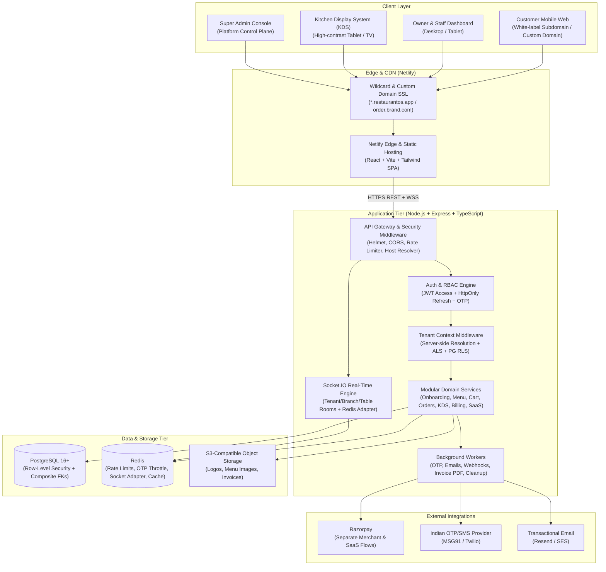
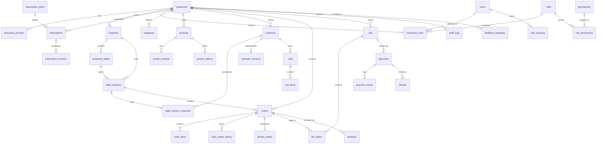
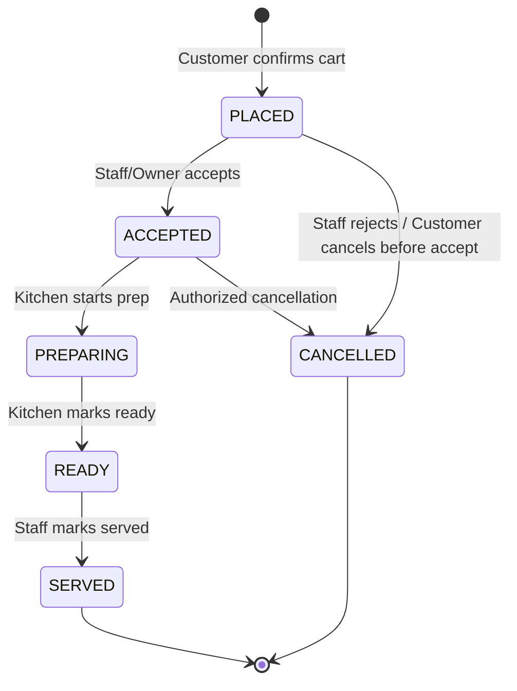

# RestaurantOS — Master System Architecture & Technical Specification

> **Classification:** Commercial Multi-Tenant White-Label SaaS  
> **Primary Market:** India (with international multi-currency/timezone readiness)  
> **Deployment Model:** Shared Cloud SaaS — Frontend on **Netlify**, Backend API & Socket.IO on **Railway / Node Cloud**, Managed **PostgreSQL + Redis + S3**

---

## 1. System Architecture Diagram

---

## 2. Complete Database ER Diagram

---

## 3. Full Prisma Schema

The complete multi-phase schema is defined in [`apps/api/prisma/schema.prisma`](../apps/api/prisma/schema.prisma), covering:
- **Platform:** `restaurants`, `restaurant_domains`, `subscription_plans`, `subscriptions`, `subscription_invoices`, `platform_settings`
- **Organization & RBAC:** `branches`, `users`, `user_sessions`, `roles`, `permissions`, `role_permissions`, `restaurant_users`
- **Operations & Sessions:** `restaurant_tables`, `table_sessions`, `table_session_customers`, `customers`, `customer_sessions`, `otp_verifications`
- **Menu:** `categories`, `products`, `product_variants`, `product_addons`
- **Ordering & KDS:** `carts`, `cart_items`, `orders`, `order_items`, `order_status_history`, `kitchen_tickets`
- **Billing & Payments:** `bills`, `bill_orders`, `payments`, `payment_events`, `refunds`
- **Feedback & Operations:** `feedback`, `feedback_templates`, `notifications`, `audit_logs`, `file_uploads`

Every tenant-owned table carries `restaurant_id` and uses composite unique keys + composite foreign keys where needed so cross-tenant links are impossible at the database layer.

---

## 4. Tenant Isolation Strategy (5-Layer Defense)

1. **Authentication Layer:** Staff/Owner JWTs bind `userId`, `sessionId`, `restaurantId`, and `roleId`. Customer JWTs bind `customerId`, `restaurantId`, and `tableSessionId`. Super Admin tokens are explicitly scoped with `isSuperAdmin: true` and cannot impersonate tenant-scoped mutations without audit logging.
2. **API Middleware Layer (`resolveTenantContext`):**
   - Never trusts `restaurant_id` or `tenant_id` from request body, query params, or custom headers (`X-Tenant-Id` is ignored for authorization).
   - Resolves tenant exclusively from:
     - Verified `Host` / `X-Forwarded-Host` domain mapping (`restaurant_domains`) for public/customer routes, OR
     - Authenticated JWT membership (`restaurant_users` / `customers`) verified against the database.
   - If both a verified domain and an authenticated token are present, they **must match**, otherwise `403 Forbidden`.
3. **Service Layer:** Every tenant-scoped service method requires a typed `TenantContext` (`{ restaurantId, branchId?, actorId, actorType }`) and never accepts raw unvalidated tenant IDs.
4. **Database Query Layer:** Prisma Client Extension / scoped repository helpers automatically inject `where: { restaurantId }` and validate ownership before `update`/`delete`.
5. **PostgreSQL Row-Level Security (RLS):** Transaction-scoped `SET LOCAL app.current_restaurant_id = '<uuid>'` combined with RLS policies on tenant tables provides database-level enforcement even against accidental query omissions.

### Deliberate Exceptions to Tenant Scoping
- `platform_settings`, `subscription_plans`, `permissions`, and global `roles` (`restaurantId IS NULL`) are platform-level records managed by Super Admin.
- `users` is a global identity table (one email/phone can own or work at multiple restaurants via `restaurant_users`).
- `restaurant_domains` is queried during pre-auth host resolution to map a verified hostname to a `restaurant_id`.

---

## 5. White-Label Domain Resolution Architecture

- **Supported Patterns:**
  1. Fallback path: `restaurantos.app/r/:slug` (or `/menu/:slug` in dev)
  2. Subdomain: `:slug.restaurantos.app` (Starter+)
  3. Custom Domain: `order.custombrand.com` (Professional+, requires DNS TXT/CNAME verification + `status = VERIFIED` + `isActive = true`)
- **Host Header Validation:**
  - Strip port, normalize lowercase, validate against RFC hostname regex.
  - Reject unrecognized/unverified custom domains with a safe `404` / neutral fallback page (never leak another tenant's branding).
- **Theme Hydration:** `GET /api/v1/public/tenant-context` returns sanitized public branding (name, logoUrl, primaryColor, secondaryColor, backgroundColor, fontFamily, menuLayout) which the React `ThemeProvider` injects into CSS custom properties (`--brand-primary`, `--brand-secondary`, etc.).

---

## 6. Authentication & Authorization Architecture

- **Owner / Staff / Super Admin Auth:**
  - Password hashing with `argon2` / `bcryptjs` (cost 12).
  - Short-lived JWT Access Token (15m) + `HttpOnly`, `Secure`, `SameSite=Lax` Refresh Token Cookie stored as a SHA-256 hash in `user_sessions` (revocable, rotated on refresh).
  - Account lockout / rate limiting on failed login attempts.
- **Customer Auth (Phase 3+):**
  - Phone + OTP verification with 5-minute TTL, max 5 attempts, Redis/DB rate limiting, and hashed OTP storage (`otp_verifications`). Never log OTPs.
- **Permission-Based RBAC:**
  - Middleware `requirePermission('orders:write')` checks resolved permissions from `role_permissions` (and optional per-user overrides), not frontend role strings.
  - Subscription guard middleware verifies tenant `status === 'ACTIVE'` and plan feature entitlements (e.g., `customDomainEnabled`, `maxBranches`, `maxStaff`).

---

## 7. API Endpoint Documentation (Core & Phase 1–9)

| Module | Method & Path | Auth | Description |
| :--- | :--- | :--- | :--- |
| Health | `GET /api/v1/health` | Public | Liveness & DB readiness check |
| Auth | `POST /api/v1/auth/register` | Public | Register owner account & create initial restaurant |
| Auth | `POST /api/v1/auth/login` | Public | Authenticate user, issue access token & refresh cookie |
| Auth | `POST /api/v1/auth/refresh` | Cookie | Rotate refresh token and issue new access token |
| Auth | `POST /api/v1/auth/logout` | Auth | Revoke current session & clear refresh cookie |
| Auth | `GET /api/v1/auth/me` | Auth | Current user profile, memberships, and permissions |
| Tenant | `GET /api/v1/public/tenant-context` | Public | Resolve branding & status by Host header or `?slug=` |
| Tenant | `GET /api/v1/restaurant/profile` | Owner/Staff | Get current tenant restaurant profile (tenant-isolated) |
| Tenant | `PATCH /api/v1/restaurant/profile` | `restaurant:write` | Update restaurant profile & branding |
| Staff | `GET /api/v1/staff` | `staff:read` | List staff members for current tenant |
| Staff | `POST /api/v1/staff` | `staff:write` | Invite/create staff member with role |
| Admin | `GET /api/v1/admin/restaurants` | Super Admin | List all platform tenants |
| Admin | `PATCH /api/v1/admin/restaurants/:id/status` | Super Admin | Activate / suspend tenant |
| *Phases 2–8* | `/branches`, `/tables`, `/menu`, `/cart`, `/orders`, `/kds`, `/bills`, `/payments`, `/feedback`, `/subscriptions` | Scoped | Implemented incrementally per phase |

---

## 8. Order Lifecycle State Machine

Every transition is validated server-side against an explicit transition map, recorded in `order_status_history` with `changedBy`, `reason`, and `timestamp`, and broadcast via Socket.IO to `tenant:{restaurantId}:branch:{branchId}` and `session:{tableSessionId}`.

---

## 9. Billing & Payment Architecture

- **Strict Financial Separation:**
  - **Flow A (Food Orders):** Customer -> Restaurant's configured Razorpay Merchant Account. `bills` -> `bill_orders` (1 order cannot be billed twice) -> `payments` -> `payment_events` (idempotent webhook processing via `razorpay_event_id` unique constraint) -> `refunds`.
  - **Flow B (SaaS Subscriptions):** Restaurant Owner -> RestaurantOS Platform Razorpay Account -> `subscription_invoices`.
- **Admin-Controlled Billing:** Orders must be approved into an individual or combined table-session `bill` by authorized staff/owner. Line items store historical price snapshots (`unitPriceSnapshot`, `taxRateSnapshot`).

---

## 10. SaaS Subscription Architecture

- Plans (`STARTER`, `PROFESSIONAL`, `ENTERPRISE`) define `monthlyPriceInr`, `annualPriceInr`, `maxBranches`, `maxStaff`, `customDomainEnabled`, `advancedBrandingEnabled`.
- Expiry handling: `ACTIVE` -> `GRACE_PERIOD` -> `PAST_DUE` / `EXPIRED` (read-only/restricted mode; **never** deletes restaurant data).

---

## 11. Security Threat Model

| Threat | Mitigation |
| :--- | :--- |
| Cross-tenant IDOR (`restaurant_id` spoofing) | Ignore client `restaurant_id`; derive from JWT/verified Host; composite FKs + PG RLS; automated cross-tenant tests |
| Unverified custom domain hijacking | Require DNS verification token + Super Admin/automated verification before `isActive = true` |
| Payment spoofing / double webhook | Server-side Razorpay order creation, HMAC-SHA256 signature verification, idempotent `event_id` table |
| OTP brute force / enumeration | 5-min expiry, max 5 attempts, per-IP & per-phone rate limits, hashed OTPs, no OTP logging |
| XSS / CSRF / Clickjacking | Helmet CSP/headers, `HttpOnly` SameSite cookies, Zod input validation, React auto-escaping |

---

## 12. Development Roadmap & Netlify Deployment Fit

- **Phase 1 (Current):** Monorepo foundation, full Prisma schema, PostgreSQL + RLS migration, Auth + RBAC + Multi-tenant isolation, Design System foundation, `netlify.toml`, `start-server.js`, automated unit/integration/cross-tenant tests.
- **Phase 2:** Onboarding flow, Branding engine, Branches, Custom Domains & Tables/QR tokens.
- **Phase 3:** Menu management, Customer OTP auth & Persistent PostgreSQL Carts.
- **Phase 4:** QR ordering & Multi-customer Table Sessions.
- **Phase 5:** Kitchen Display System (KDS) & Socket.IO real-time updates.
- **Phase 6:** Admin-controlled Billing, Invoices & Razorpay integration.
- **Phase 7:** Customer Feedback, Reports & Analytics.
- **Phase 8:** Super Admin Console & SaaS Subscriptions.
- **Phase 9:** Security audit, full E2E suite, staging/production verification & backup drills.
